# Mandate

Mandate is a bounded-authority AI shopping and payment-control system built with FastAPI, React, PostgreSQL 17, Alembic, and a PayPal Sandbox execution adapter. A human user sets a time- and budget-capped spending grant, the AI shopping agent (or direct proposal client) submits carts through deterministic `P01`–`P11` policy checks and `cart_hash` binding, approved purchases reserve funds atomically in PostgreSQL, and execution routes through either PayPal Sandbox **Autonomous (vaulted)** setup/charging (`vault_id`, verified live in PayPal Sandbox on Nov 12, 2026) or **Buyer approves each purchase** checkout with a durable outbox, reconciliation worker, and SHA-256 hash-chained audit ledger.

## Current Verification Status (Honest Summary)

### Verified by Live Sandbox Run (Nov 12, 2026)
- **Live PayPal Sandbox end-to-end vault check passed** (`scripts/live_vault_check.py`, no IDs or secrets stored):
  - Vault grant stored (Fernet-encrypted) and `$1.00` setup authorization auto-refunded.
  - `$349.00` catalog proposal approved against policy and `cart_hash` binding.
  - Autonomous `vault-charge` captured (`COMPLETED` confirmed via `PayPal GET /v2/checkout/orders/{id}`).
  - Partial refund of `$314.10` (`31410` cents) executed through a bounded recovery case.
  - SHA-256 hash-chained audit ledger verified valid across `10` events.

### Verified by Automated Offline Tests
- **201 backend tests passed** (`pytest apps/api/tests -q --tb=short`, loopback-only socket guard `127.0.0.1,::1`, mocked PayPal/Groq HTTP transports, PostgreSQL 17 disposable schemas):
  - Hypothesis property tests (`@seed(42)`), 15 Break-the-Mandate attack simulations (`0` breaches, `0` payment rows created), Fernet vault grant/charge/reconciliation mocks, `PAYMENT.CAPTURE.REFUNDED` + `PAYMENT.CAPTURE.COMPLETED` webhook signature/authoritative-`GET` mocks, LLM retry/backoff/fallback mocks, instruction constraint extraction (`ESCALATE`-only in `P09`), `PUBLIC_DEMO` isolation/rate-limits, offline `scripts/predeploy_check.py`, and `scripts/discover_merchant.py`.
- **14+ frontend boundary tests passed** (`npm test`), plus TypeScript typecheck (`tsc -b`) and Vite production build (`vite build`).
- **Synthetic 100-scenario evaluation passed** (`scripts/run_evals.py` -> [eval_results.json](eval_results.json), labeled *Synthetic: scripted scenarios written by the author*): **`8 attack kinds, 50 variants`** with **`50 of 50 blocked (95% CI 92.86-100.0%)`**, **`0 of 50 false positives (95% CI 0.0-7.14%)`**, **`10 of 50 escalated (95% CI 11.24-33.04%)`** on legitimate carts, `p50=0.918 ms`, `p95=1.311 ms`.

### Still Unverified in External Environments
- Signed PayPal webhook delivery (`PAYMENT.CAPTURE.COMPLETED` and `PAYMENT.CAPTURE.REFUNDED`) over a public HTTPS URL.
- Live hosted Render deployment (`render.yaml`) and Docker Compose execution (`compose.production.yaml`).
- Live GroqCloud API tool-calling response (`scripts/check_llm.py` — placeholder: `<TODO: run scripts/check_llm.py and paste timestamp/model>`).

## Demo Defaults and What Is Real vs. Mocked

- **Demo defaults**: **$500.00 budget**, **$400.00 per-purchase cap**, allowed merchant **`demo-merchant`**, allowed categories **`office_furniture` (`furniture` in catalog) and `electronics`**.
- **What is real**: FastAPI backend, PostgreSQL 17 persistence and row-locked atomic reservations (`spent_cents + reserved_cents <= budget_cents`), Alembic schema migrations (`0001`–`0004`), `P01`–`P11` policy engine, SHA-256 hash-chained audit ledger, CSRF + `HttpOnly`/`SameSite=Strict` sessions, DB-backed rate limits, Fernet encryption for `vault_token_ref`, durable `Operation` outbox + `ReconciliationLease` worker, 15 Break-the-Mandate attacks, and React dashboard.
- **What is mocked in tests**: All 186 backend tests replace external PayPal and GroqCloud HTTP endpoints with `httpx.MockTransport` / fixture clients and enforce `pytest-socket --allow-hosts=127.0.0.1,::1` so no external network calls ever run during `pytest`. Real PayPal Sandbox and GroqCloud calls only execute when running the app or operator scripts (`scripts/live_vault_check.py`, `scripts/check_llm.py`) with real credentials.

## Try It as a Judge

- **Hosted public demo URL**: `https://<TODO-RENDER-HOST>.onrender.com` (set `PUBLIC_DEMO=true` so every browser visitor automatically gets an isolated session with pre-seeded demo data or can reset via **Reset demo session**).
- **PayPal Sandbox Buyer credentials (for PayPal approval steps only)**:
  - Buyer email: `<TODO_SANDBOX_BUYER_EMAIL>`
  - Buyer password: `<TODO_SANDBOX_BUYER_PASSWORD>`
- **Screens that need NO PayPal login** (work immediately in any browser, even when PayPal is unconfigured):
  - **Overview**: inspect budget vs reserved/captured balances, create a spending grant, or revoke a grant.
  - **Shopping / Proposals**: run the shopping agent (or deterministic fallback) against the demo catalog and inspect `P01`–`P11` verdicts and `cart_hash` bindings.
  - **Break the Mandate (Attacks)**: trigger any of the 15 adversarial carts individually or run all 15 to verify zero breaches and zero payment rows created, plus view the synthetic evaluation summary.
  - **Audit Ledger**: inspect the hash-chained event log and open the `P01`–`P11` per-rule evaluation drawer on any decision row.
  - **Recovery**: open a case with **Suggest cause from description** to get a deterministic/advisory cause classification (`Accept offer` only calls PayPal when a real captured payment with a refundable balance exists and PayPal is configured).
- **Screens that DO need the PayPal Sandbox Buyer login** (if PayPal is not configured, buttons disable with an explicit notice instead of failing):
  - **Vault Grant Setup (Overview -> Enable Autonomous (vaulted) / Complete vault grant)**: opens a `$1.00` PayPal Sandbox approval flow, stores the vaulted token Fernet-encrypted, and immediately auto-refunds the `$1.00`. Once `GRANTED`, **Payments -> Charge vaulted PayPal** executes autonomously without further buyer login.
  - **Buyer-Present Checkout (Payments -> Start checkout / Fallback: buyer checkout -> Capture order after buyer approval)**: redirects to PayPal Sandbox for manual buyer approval on that single purchase.

## Why This Matters

Giving an AI agent unrestricted checkout access turns prompt injection and model hallucinations directly into financial loss. Security research from **Guardio Labs** (Scamlexity tests of agentic browsers), **Brave**, and **Palo Alto Unit 42** has demonstrated indirect prompt injection attacks against browser and shopping agents, and **OpenAI** has stated publicly that prompt injection remains an unsolved security problem. Rather than trying to make the LLM un-trickable, Mandate enforces a deterministic spending boundary between the agent and PayPal.

## How Mandate Differs

| Control / Initiative | What It Does | Gap Mandate Fills |
| --- | --- | --- |
| **OAuth scopes** | Restricts coarse API capabilities (read/write orders) | Cannot enforce integer-cent budgets, per-cart caps, item attributes, or `cart_hash` binding |
| **Card limits** | Caps total spend or velocity at the card/issuer level | Lacks per-merchant/category allowlists, ambiguity `ESCALATE` gates, and bounded refund recovery |
| **Google AP2 mandates** | Defines cryptographically signed agent payment mandate specifications | *Note: Mandate's name is AP2-inspired, not an AP2 implementation.* Mandate provides a runnable FastAPI/PostgreSQL + PayPal Sandbox reference enforcement loop today |
| **Visa and Mastercard agent controls** | Network-level tokenization and agentic commerce rails | Focuses on card-network authorization rather than local pre-dispatch `P01`–`P11` policy + post-capture bounded recovery |
| **PayPal Agent Ready** | Enables agent-initiated PayPal checkout/payment experiences | Mandate adds the local deterministic policy engine (`P01`–`P11`), outbox + `UNKNOWN` reconciliation holds, and hash-chained audit ledger in front of PayPal |

## Architecture

```mermaid
flowchart LR
  User["Human Operator / Judge"] -->|Sets grant & approves escalations| UI["React 19 Dashboard"]
  Agent["AI Shopping Agent (Groq)"] -->|Proposes product IDs| TrustBoundary["Trust Boundary (FastAPI)"]
  UI --> TrustBoundary
  TrustBoundary -->|Canonical catalog quote & cart_hash| Policy["Policy Engine (P01-P11)"]
  Policy -->|DENY / ESCALATE| Audit["SHA-256 Hash-Chained Audit Ledger"]
  Policy -->|APPROVE: atomic row-locked reservation| Outbox["Durable Operation Outbox (PostgreSQL 17)"]
  Outbox -->|Stable PayPal-Request-Id + Fernet vault_id| PayPal["PayPal Sandbox (Orders v2 / Vault / Refunds)"]
  PayPal -->|Timeout / 5xx -> UNKNOWN hold| Recon["Background Reconciliation Worker (GET Order)"]
  Recon --> Audit
  PayPal -->|Signed Webhooks + Authoritative GET| Audit
```



## Tools Used

- **Backend & Persistence**: Python 3.11+, FastAPI, SQLAlchemy, Alembic (`0001`–`0004`), PostgreSQL 17, `cryptography` (Fernet)
- **Payments**: PayPal Sandbox REST API v2 (Orders, Vault `vault_id`, Refunds, Webhook Signature Verification)
- **AI (Advisory / Proposal Only)**: GroqCloud (`openai/gpt-oss-20b` with labeled deterministic rules fallback)
- **Frontend**: React 19, TypeScript 7, Vite 8, Zod, Lucide Icons
- **Testing & Verification**: `pytest`, `pytest-socket` (loopback-only offline guard), `httpx.MockTransport`, Hypothesis (`@seed(42)`), Node test runner
- **API & Integration Artifacts**: [docs/mandate.postman_collection.json](docs/mandate.postman_collection.json) (36 endpoints generated from FastAPI OpenAPI) and [examples/guarded_agent.py](examples/guarded_agent.py) (minimal external agent proposal example)

## Run Locally

1. Install Python `3.11+`, Node.js `22.12+`, and PostgreSQL 17 (native cluster on port `55432` or `docker compose up -d db`).
2. Copy `.env.example` to `.env` and fill in `DATABASE_URL`, `POSTGRES_PASSWORD`, `VAULT_ENCRYPTION_KEY`, `PAYPAL_*` sandbox credentials, and `GROQ_API_KEY`.
3. Install dependencies, build the frontend, migrate the database, and start the server:

```powershell
python -m venv .venv
.venv/Scripts/python.exe -m pip install -r requirements-dev.lock.txt -e "./apps/api[test]"
npm.cmd --prefix apps/web ci
npm.cmd --prefix apps/web run build
.venv/Scripts/python.exe -m mandate.migrate
.venv/Scripts/python.exe -m mandate.check_setup
./scripts/run-api.ps1
```

Open [http://localhost:8000](http://localhost:8000). Use `./scripts/run-web.ps1` (`http://localhost:5173`) only when developing the frontend with Vite HMR.

## Test and Evaluation Commands

```powershell
# Offline backend test suite (loopback-only socket guard, 60s timeout)
.venv/Scripts/python.exe -m pytest apps/api/tests -q --tb=short

# Synthetic 100-scenario policy evaluation (isolated temp PostgreSQL schema, offline)
.venv/Scripts/python.exe scripts/run_evals.py

# Frontend typecheck, build, and boundary tests
npm.cmd --prefix apps/web run typecheck
npm.cmd --prefix apps/web run build
npm.cmd --prefix apps/web test

# Operator-run live checks (require real sandbox/Groq credentials in .env)
.venv/Scripts/python.exe scripts/check_llm.py
.venv/Scripts/python.exe scripts/live_vault_check.py
```

## Deploy

- **Pre-deploy offline check**: Run `.venv/Scripts/python.exe scripts/predeploy_check.py` (or `--env-file path/to/.env.prod`) before deploying. It verifies production env vars (`APP_ENV`, `PUBLIC_DEMO`, `COOKIE_SECURE`, `PUBLIC_BASE_URL` HTTPS origin, `ALLOWED_HOSTS` includes its hostname, `PAYPAL_CLIENT_ID`, `PAYPAL_CLIENT_SECRET`, `PAYPAL_MERCHANT_ID`, `PAYPAL_WEBHOOK_ID`, valid Fernet `VAULT_ENCRYPTION_KEY`, `GROQ_API_KEY`, and PostgreSQL `DATABASE_URL`) and prints a PASS/FAIL summary without printing any values.
- **PayPal Sandbox Vault & Webhooks**: In the PayPal Developer Dashboard under **Apps & Credentials -> Mandate -> Features**, enable **Vault** (Reference Transactions / PayPal Vault) so autonomous vaulted grants work; register webhook URL `https://<host>/api/webhooks/paypal` subscribed to `PAYMENT.CAPTURE.COMPLETED` and `PAYMENT.CAPTURE.REFUNDED`, and store the resulting ID in `PAYPAL_WEBHOOK_ID` (see [docs/09-paypal-sandbox-setup.md](docs/09-paypal-sandbox-setup.md)).
- **Render Blueprint**: [render.yaml](render.yaml) builds [Dockerfile](Dockerfile), runs `python -m mandate.migrate` before starting Uvicorn, sets `PUBLIC_DEMO=true`, `APP_ENV=production`, `COOKIE_SECURE=true`, `PAYPAL_ENV=sandbox`, and binds a managed PostgreSQL database (`mandate-db` — remember to upgrade from Render's free Postgres tier before the 30-day expiry during judging).
- **Docker Compose**: [compose.production.yaml](compose.production.yaml) runs PostgreSQL 17, one-shot `migrate`, and the non-root `app` container with `APP_ACCESS_KEY` operator authentication.
