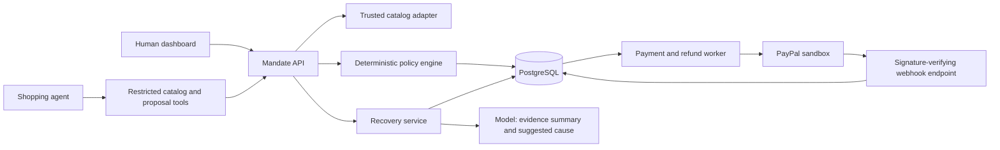

# Architecture

Status: proposed design, October 28, 2026. Domain behavior in this file is authoritative for the [build tasks](03-build-plan.md).

## Shape of the application

Use the dossier's React and TypeScript frontend with a Python FastAPI backend. Keep business modules in one application and use PostgreSQL in development, integration tests, and deployment. SQLite cannot validate the planned row-locking behavior. Serve the frontend and API from one origin where practical.

Use a durable database job table and a small polling worker in the same application deployment. Avoid Redis, a separate workflow platform, and microservices for the MVP. A restart must resume persisted work. The worker's leases prevent multiple instances from dispatching the same operation.

Only the payment adapter can call PayPal. Use direct REST calls or a supported server SDK behind that adapter. The PayPal Agent Toolkit is optional and must not expose raw payment tools to the shopping model.

## Trust boundaries

| Actor or input | Allowed | Forbidden |
| --- | --- | --- |
| Human session | Create/revoke grants, approve escalations, accept a refund | Access another session's records |
| Shopping agent capability | Read approved catalog data, submit proposals, inspect its results | Change grant limits, approve itself, select arbitrary payees, call refunds |
| Recovery model | Suggest a cause and explanation with evidence references | Set payment authority, issue refunds, or silently change the accepted amount |
| Catalog and provider adapters | Supply validated records and authenticated provider results | Treat listing text as executable instructions |
| Public webhook request | Enter signature verification | Change financial records before verification |

Store PayPal secrets and saved tokens only on the server. Keep them out of model context, browser responses, logs, and agent tools. The model gets no shell, generic HTTP tool, or arbitrary URL fetcher. Grant-scoped agent capabilities are separate from the human session cookie and expire after a proposed 15 minutes, capped by grant expiry.

Prefer a consent-only saved-method setup if the sandbox supports it. If vault setup requires a purchase, route that order through the same proposal, reservation, and accounting path under buyer approval. A setup charge must never bypass the ledger. Keep feasibility-test purchases separate from the fresh grant used for demo acceptance scenarios.

Every object lookup checks session ownership. State-changing browser requests use CSRF protection; the human cookie is HttpOnly, Secure, and SameSite. Request bodies cannot set server-owned status, trusted merchant mappings, or approval flags. Enforce a sandbox-only provider allowlist and reject live configuration in the demo deployment.

## Modules and contracts

| Module | Responsibility | Output |
| --- | --- | --- |
| Sessions and grants | Human authority, payment-method association, revocation | Versioned grant and scoped capability |
| Catalog | Resolve product IDs to merchant, category, attributes, and final quote | Immutable quote with source, currency, fees, and expiry |
| Policy | Evaluate constraints and dynamic spending limits | Decision, per-rule results, and evidence |
| Payments | Reserve, dispatch, reconcile, and account for captures | Payment state and durable operation records |
| Recovery | Assemble evidence and enforce merchant refund policy | Versioned human-reviewable refund offer |
| Audit | Append decision and money-movement events | Ordered per-session history with hash verification |
| Agent runner | Bound model turns and dispatch permitted tools | Proposal and a short user-facing explanation |
| Dashboard | Present grant, purchase, attack, ledger, and case flows | Human actions through the API |

The catalog adapter owns merchant identity and price. The client supplies product IDs, quantities, grant ID, and a purchase-intent ID. Code fetches canonical values. Any suggested price is treated as a comparison input, never as an executable charge amount.

## Stored records

- **Session and grant.** Owner, status, expiry, confirmed constraints, merchant allowlist, USD caps, policy version, and payment-method reference. A material grant change creates a new version and invalidates unexecuted approvals.
- **Merchant and quote.** Trusted PayPal payee mapping, catalog provenance, product attributes, total including tax/shipping/fees, and validity time.
- **Proposal.** Purchase-intent ID, canonical cart snapshot, cart hash, grant version, rule results, decision, expiry, and any human approval.
- **Payment and operation.** Reservation, provider order/capture IDs, amounts, operation kind, request key, payload hash, state, lease, attempts, and next reconciliation time.
- **Case and refund.** Evidence references, proposed and human-confirmed cause, policy version, accepted offer hash, refundable balance, provider refund ID, and status.
- **Webhook and audit event.** Provider event ID, verification result, processing status, event sequence, actor, request correlation, and hash-chain fields.

Use integer cents everywhere internally and exact decimal strings at the provider boundary. USD is the only accepted currency. Reject malformed values, negative amounts, and unsupported precision. Use UTC for persisted timestamps and display IST in planning and operator views.

## Policy rules

DENY takes precedence over ESCALATE, which takes precedence over APPROVE. A model can request additional review but cannot turn a hard failure into approval. The human confirms extracted purchase constraints when granting authority; the model cannot quietly omit them later.

| ID | Check | Required result |
| --- | --- | --- |
| P01 | Active, unexpired grant and valid caller | Deny if invalid |
| P02 | Total plus spent plus active reservations fits budget | Deny if exceeded; check atomically |
| P03 | Total fits transaction cap | Deny if exceeded |
| P04 | Trusted merchant ID and actual PayPal payee are allowed | Deny otherwise; human can create a revised grant |
| P05 | Catalog category is permitted | Deny if disallowed or unavailable |
| P06 | Products, quantity, exact quote, fees, and USD reconcile | Deny invalid data; escalate unavailable or expired quotes |
| P07 | Purchase slots in the rolling hour fit velocity limit | Deny if exceeded; count reserved/in-flight slots too |
| P08 | Purchase intent and idempotency identity | Return the original result for retries; reject changed payload under the same key |
| P09 | Confirmed purchase constraints match catalog attributes | Escalate missing attributes; deny explicit mismatches |
| P10 | No recurring or auto-renewing purchase | Deny subscriptions in this MVP |
| P11 | Near-limit or merchant not previously approved by the human | Escalate above 80% of transaction cap; grant approval can pre-approve the merchant |

For P08, a new key with the same recent cart is an additional duplicate warning that escalates. A cart hash alone is not an idempotency key because a human may intentionally buy the same item twice.

Evaluate cheap local checks first. If a hard denial makes a catalog fetch unnecessary, record dependent checks as NOT_RUN, never PASS. If fetched evidence is available, show every applicable result. Defaults are a 60-second quote lifetime and a five-minute human review deadline. Escalation approval requires a fresh proposal and quote. Approved reservations revalidate their canonical cart and current grant policy at dispatch, refreshing an expired quote only when the cart hash stays identical.

Human approval addresses named escalation reasons on the exact proposal hash. It cannot waive a hard denial. Human approval checks the review deadline. Worker dispatch rechecks grant expiry, grant version, revocation, quote validity, budget, and velocity. Budget and velocity are reserved under the same grant lock.

## Purchase and accounting flow

1. Authenticate the caller and deduplicate its purchase-intent ID. Obtain a trusted quote and evaluate the proposal.
2. On approval, lock the grant row in a short PostgreSQL transaction. Recheck dynamic limits, reserve money and a velocity slot, persist the immutable cart and a dispatch job, then commit.
3. The worker claims the job. It reconstructs the order exclusively from stored data, verifies the canonical SHA-256 hash, and validates the trusted payee. The execution input is only a proposal ID.
4. Persist separate operation IDs for create, capture, and refund before their network calls. Reuse the same PayPal-Request-Id for a retry of the same operation. Never reuse one across operation types or changed payloads. Provider retention is finite, so local deduplication remains authoritative. [PayPal idempotency](https://developer.paypal.com/api/rest/reference/idempotency/)
5. A completed capture moves the reservation to spent exactly once. A pending response or lost response retains the reservation. A verified provider lookup or webhook may resolve the outcome.
6. Release a reservation only after definitive evidence of no charge, or after cancelling an operation that was never dispatched. A timer or process crash is not proof of failure. Do not blindly recreate or recapture an unresolved payment after the provider's retry window.

Do not hold database transactions open during network calls. The job is written in the same transaction as the reservation, preventing a crash from leaving authorized work without a durable record.

The invariant is `spent_cents + reserved_cents <= budget_cents`. Spent means gross completed captures. Refunds and reversals are tracked separately and do not automatically restore spending authority in the MVP. Display gross spending, refunds, and net outflow separately.

Revocation and dispatch use the same grant lock. Revocation prevents operations not yet authorized for dispatch. An operation already dispatched may still complete and must reconcile; the UI explains that boundary.

## States and reconciliation

| Record | States and transition rules |
| --- | --- |
| Proposal | RECEIVED to DENIED, ESCALATED, or APPROVED; an unexecuted approval can become EXPIRED or CANCELLED |
| Payment | RESERVED to ORDER_CREATED to CAPTURE_PENDING or CAPTURED; ambiguous outcomes enter UNKNOWN; definitive no-charge outcomes become FAILED then RELEASED |
| Case | OPEN to PROPOSED to ACCEPTED or REJECTED; accepted offers enter REFUND_PENDING, then REFUNDED, REFUND_FAILED, or UNKNOWN |

Track `provider_status` and `webhook_verified_at` separately. A synchronous completed capture is already real; it must not wait for a webhook before reducing available budget. The dashboard can show "captured, webhook awaited" or "captured, verified webhook received."

Verify webhook signatures with PayPal's verification endpoint and the configured webhook ID. Deduplicate on provider event ID and apply only valid transitions. Keep raw payloads for verification with restricted access, and redact them from normal logs. A verified event must also match the known merchant, currency, amount, and provider object. [PayPal webhook verification](https://developer.paypal.com/api/webhooks/v1/verify-webhook-signature-post)

Retry signature-verification outages without treating events as verified. Persist verified events before acknowledging them, then process idempotently. Out-of-order events cannot revert a completed payment to pending. After a proposed 30-second webhook delay, reconcile through provider GET endpoints; unresolved operations remain visible and reserved. Provider 429/5xx responses use bounded backoff, not new operation IDs.

## Recovery and audit

Only an authenticated human can open a case and accept a refund offer. Permit one active case per payment. Feed the model the original instruction, confirmed constraints, catalog snapshot, fulfillment evidence, and transaction facts. Store a short evidence-based explanation, not hidden model reasoning.

Retain the dossier's initial merchant-policy bands as demo assumptions: seller error 90-100%, ambiguous listing 40-70%, agent error 70-100%, and vague instruction 0-30%. The model suggests a cause; the human confirms it. Code chooses the amount by clamping avoided return freight plus expected resale loss to the selected band's currency bounds and the remaining refundable amount. Round once to cents. Missing evidence or economic inputs requires manual review.

Freeze the accepted offer, cause, evidence version, and amount. Lock the payment while reserving a refund so that completed plus pending refunds never exceed the captured amount. Acceptance cannot submit a replacement amount. An unknown refund retains its reservation until provider reconciliation. Only the merchant-authorized payment adapter can refund. [PayPal capture refunds](https://developer.paypal.com/api/payments/v2/captures-refund)

Audit decision, approval, dispatch, capture, revoke, and refund transitions in their corresponding database transactions. Serialize each session's audit sequence and hash each event with its predecessor. This detects alteration relative to a retained checkpoint; it is not tamper-proof against an administrator who can rewrite the entire database and chain. Export a checkpoint with demo evidence.

## Proposed API contracts

| Endpoint group | Caller and contract |
| --- | --- |
| Sessions and payment setup | Human only; bind setup state and PayPal callback to the same session; show usable-vault status |
| POST /mandates; GET /mandates/{id}; POST /mandates/{id}/revoke | Human writes, scoped reads; return policy version and available budget |
| GET /catalog; POST /agent-runs | Human starts a bounded run; model tools receive only the permitted catalog and proposal capabilities |
| POST /proposals; GET /proposals/{id} | Agent or human; validated intent and line items; returns rule results and lifecycle status |
| POST /proposals/{id}/approve | Human only; exact proposal version/hash; reevaluate before reservation |
| GET /ledger; GET /ledger/stream | Human; session-filtered history with resumable event sequence; polling fallback |
| POST /cases; GET /cases/{id}; POST /cases/{id}/accept; POST /cases/{id}/reject | Human only; acceptance binds the existing offer hash |
| POST /webhooks/paypal | Provider signature verification, independent of browser sessions |
| POST /attacks/run; POST /demo/reset | Human; session-scoped, rate-limited operations using the normal policy path |

Reset creates a fresh demo session after handling in-flight work. It cannot erase financial history, bypass limits on the old session, or reset another visitor. Apply deployment-wide limits to model calls and sandbox operations so new sessions cannot evade cost controls. Judge access needs a documented exception if public abuse protection blocks legitimate evaluation.

Deploy on persistent infrastructure that lasts through judging. The operational runbook must cover expired tokens, pending payments, job recovery, database restoration, and disabling new purchases while reconciliation continues.
